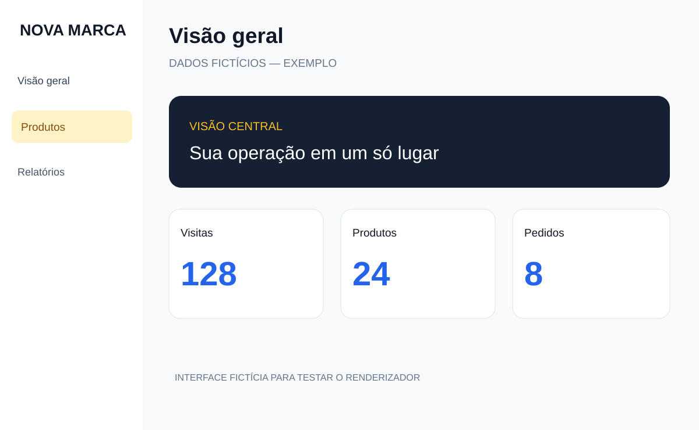

# Brand Motion V27

**Skill universal para criar vídeos promocionais e demonstrações de produtos com agentes de IA.** Compatível com **Codex, Claude Code, OpenCode e Hermes** que suportem Agent Skills e execução local de scripts.

Gera vídeos **Full HD 1920×1080, 16:9, 30 FPS**. **HyperFrames (CLI oficial) é o motor preferencial**; Python + Playwright/Chromium + FFmpeg permanece disponível como alternativa, especialmente para projetos legados. O template cria uma apresentação com 4 segundos de explicação, 3,5 segundos de zoom centralizado, navegação sincronizada (para software) e um CTA final. Suporta **SaaS, aplicativos, sites, e-commerce, produtos físicos, lojas e serviços**. Não depende de API paga e não é um gerador de vídeos 3D/realistas por IA.



> **Segurança e privacidade:** este repositório contém **somente o motor genérico, a skill e exemplos fictícios**. Não inclui vídeos do Aegis Forge, telas reais de clientes, tokens ou credenciais. Antes de produzir, forneça somente materiais que você tem autorização para usar.

## Requisitos

- [Python 3.10+](https://www.python.org/downloads/)
- [FFmpeg + FFprobe](https://ffmpeg.org/download.html), disponíveis no `PATH`
- [Git](https://git-scm.com/downloads) (para clonar o projeto)
- Bibliotecas Python: Playwright, NumPy e Pillow (arquivo `requirements.txt`)
- Chromium instalado pelo Playwright: `python -m playwright install chromium`

**Para usar HyperFrames (recomendado):** Node.js 22+, FFmpeg, CLI HyperFrames e skills oficiais. Python 3.10+ também é usado pelo exportador Brand Motion. GSAP, Remotion e Three.js não são necessários ao baseline; GSAP pode ser usado para novas timelines. Sem HyperFrames, use o fallback Playwright documentado abaixo.

## 1. Clonar

```bash
git clone https://github.com/YutsuKito/Brand-Motion.git
cd Brand-Motion
```

## HyperFrames — motor recomendado

Além da skill Brand Motion, instale as skills oficiais do HyperFrames e o CLI:

~~~powershell
node --version
npm install -g hyperframes
npx skills add heygen-com/hyperframes
npx hyperframes doctor
~~~

Crie um projeto HyperFrames, exporte o seu manifest Brand Motion e renderize:

~~~powershell
npx hyperframes init meu-video --example blank
python .\brand-motion-v27\scripts\export_hyperframes.py --config .\brand-motion-v27\examples\demo-saas\manifest.json --project .\meu-video --replace
cd meu-video
npx hyperframes lint
npx hyperframes preview
npx hyperframes render --output final.mp4 --fps 30 --quality high
~~~

O exemplo é fictício; substitua os assets antes de publicar. O exportador utiliza o protocolo seekable do HyperFrames, mas **a execução do CLI ainda depende de validação na máquina do agente**. Neste ambiente, o npm estava indisponível, então não declaramos um render HyperFrames aprovado. Use o fallback Python se necessário. Guia detalhado: [HyperFrames e integração](brand-motion-v27/references/hyperframes.md).

## 2. Instalar a skill em todos os agentes

**Windows / PowerShell**:

```powershell
python .\brand-motion-v27\scripts\install_skill.py --agent all --scope user
```

**Linux / macOS**:

```bash
python3 brand-motion-v27/scripts/install_skill.py --agent all --scope user
```

Use `--agent codex`, `--agent claude`, `--agent opencode` ou `--agent hermes` para apenas um agente. Teste primeiro com `--dry-run`; use `--replace` somente quando quiser atualizar uma instalação existente. Para instalar em um projeto:

```bash
python brand-motion-v27/scripts/install_skill.py --agent all --scope project --root .
```

| Agente | Pasta do usuário |
| --- | --- |
| Codex | `~/.agents/skills/brand-motion-v27/` |
| Claude Code | `~/.claude/skills/brand-motion-v27/` |
| OpenCode | `~/.config/opencode/skills/brand-motion-v27/` |
| Hermes | `~/.hermes/skills/brand-motion-v27/` |

O Hermes usa seu diretório global como destino nativo; para pastas adicionais por projeto consulte [as instruções da skill](brand-motion-v27/references/install-agents.md). Reinicie ou recarregue a sessão do agente após instalar. **O instalador não instala os programas de IA nem FFmpeg.**

## 3. Instalar o motor de vídeo

**Windows / PowerShell**:

```powershell
python -m venv .venv
.\.venv\Scripts\Activate.ps1
python -m pip install -r brand-motion-v27/requirements.txt
python -m playwright install chromium
python brand-motion-v27/scripts/doctor.py
```

**Linux / macOS**:

```bash
python3 -m venv .venv
source .venv/bin/activate
python -m pip install -r brand-motion-v27/requirements.txt
python -m playwright install chromium
python brand-motion-v27/scripts/doctor.py
```

O FFmpeg é instalado **separadamente**. Se o Chromium estiver bloqueado por política empresarial, peça autorização ao administrador — não contorne restrições.

## 4. Executar o exemplo

```bash
python brand-motion-v27/scripts/validate_project.py --config brand-motion-v27/examples/demo-saas/manifest.json
python brand-motion-v27/scripts/render_video.py --config brand-motion-v27/examples/demo-saas/manifest.json --output output/demo --preview-only
python brand-motion-v27/scripts/render_video.py --config brand-motion-v27/examples/demo-saas/manifest.json --output output/demo --allow-placeholders
```

Abra `output/demo/storyboard.jpg` para conferir a prévia e `output/demo/final.mp4` para ver o vídeo. O exemplo possui imagens sintéticas, então `--allow-placeholders` é **somente para testes**. Não anuncie demonstrações fictícias como funcionalidades reais.

**Retomar renderização interrompida**: repita o comando de exportação com `--resume`, **somente se o manifest e os assets não tiverem sido alterados**.

## 5. Criar um vídeo para a sua marca

Peça a qualquer agente instalado:

> Use a skill `brand-motion-v27` para criar uma demonstração do meu produto. Comece perguntando sobre a marca, site, público, objetivo, CTA e materiais. Solicite fotos, screenshots, logos e links de referência. Gere storyboard, MP4, projeto editável e QA.

O agente vai pedir **nome/site, o que o produto faz, onde o vídeo será publicado, CTA, imagens e referências**; respostas parciais são aceitas. Fotos e prints reais são preferenciais. Sem licença de uso ou confirmação de funcionalidade, o agente deve informar a limitação em vez de inventar.

Crie seu projeto a partir de [`templates/project.example.json`](brand-motion-v27/templates/project.example.json), adicione imagens à pasta do projeto e ajuste as cenas no `manifest.json`. O gerador também suporta produtos e lojas, usando fotografias e zoom suave em vez de simular cliques.

## Arquivos principais

- [`brand-motion-v27/SKILL.md`](brand-motion-v27/SKILL.md) — fluxo e regras do agente
- [`scripts/install_skill.py`](brand-motion-v27/scripts/install_skill.py) — instalação nos agentes
- [`scripts/doctor.py`](brand-motion-v27/scripts/doctor.py) — diagnóstico
- [`scripts/export_hyperframes.py`](brand-motion-v27/scripts/export_hyperframes.py) — exportação seekable para projetos oficiais HyperFrames
- [`scripts/render_video.py`](brand-motion-v27/scripts/render_video.py) — captura de frames, storyboard e MP4
- [`scripts/audio.py`](brand-motion-v27/scripts/audio.py) — trilha original e efeitos de clique
- [`scripts/qa.py`](brand-motion-v27/scripts/qa.py) — QA de áudio, vídeo e duração
- [`engine/composition.html`](brand-motion-v27/engine/composition.html) — composição visual
- [`examples/`](brand-motion-v27/examples/) — dois projetos fictícios

## Verificação de publicação

Os arquivos publicados passaram por revisão estática de padrões de segredos, arquivos de configuração privados e caminhos locais, além de testes básicos de sintaxe e renderização de prévia. **Isso não equivale a uma auditoria de segurança exaustiva**. Veja [`SECURITY.md`](SECURITY.md).

## Licença e assets

Este repositório não inclui licença de software explícita; até que uma licença seja definida pelo proprietário, a publicação pública não concede automaticamente direitos de redistribuição. Logos, fotos, vídeos e músicas de terceiros exigem autorização específica. Consulte [`brand-motion-v27/NOTICE.md`](brand-motion-v27/NOTICE.md).
